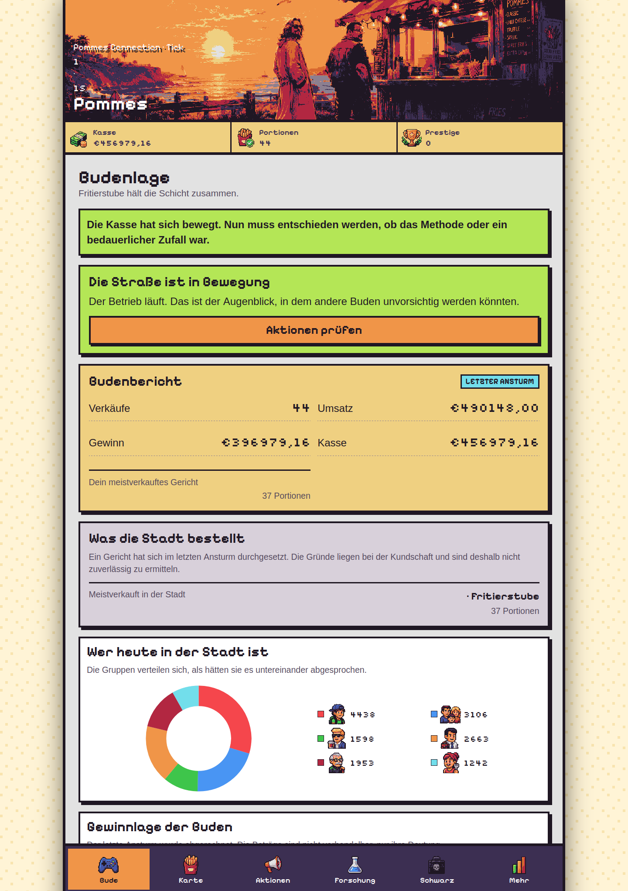
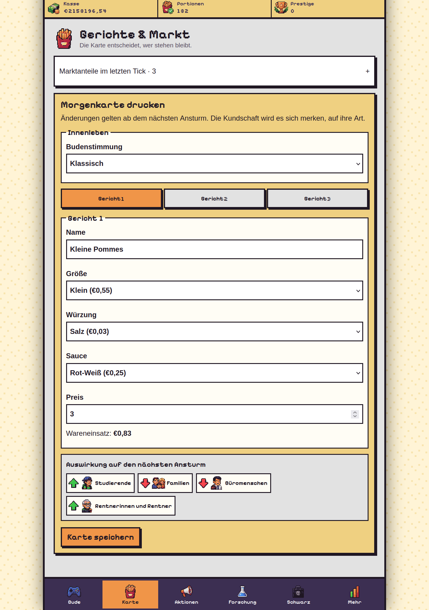
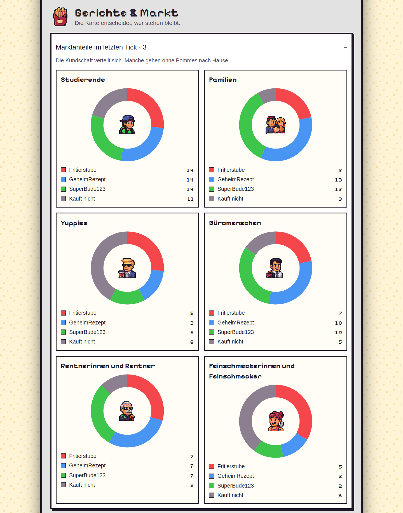
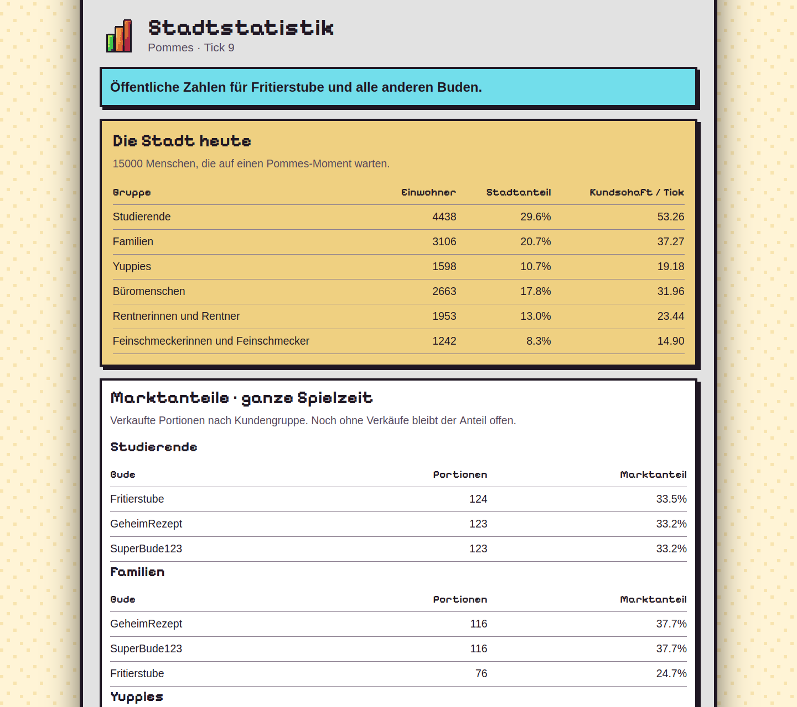
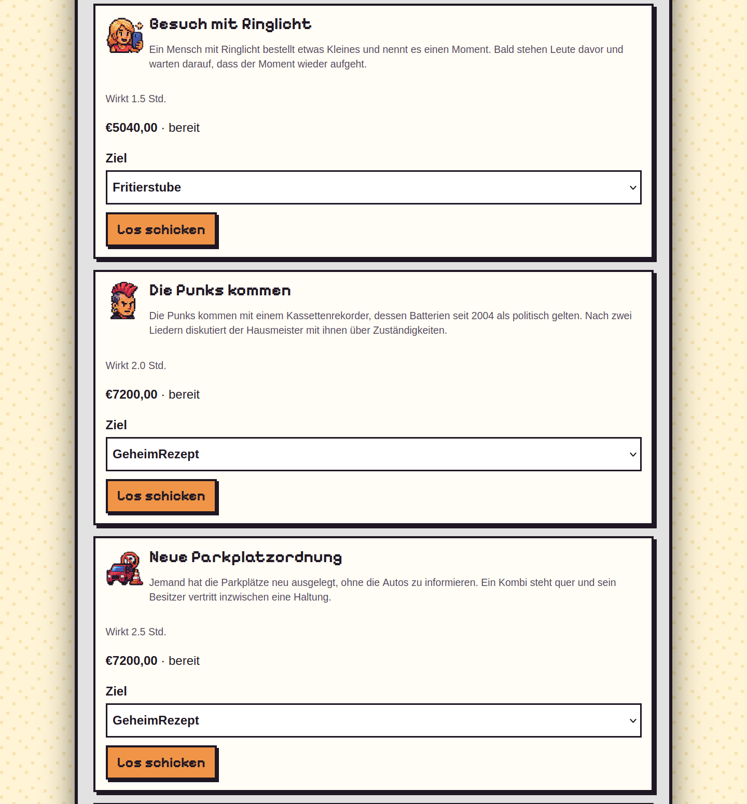
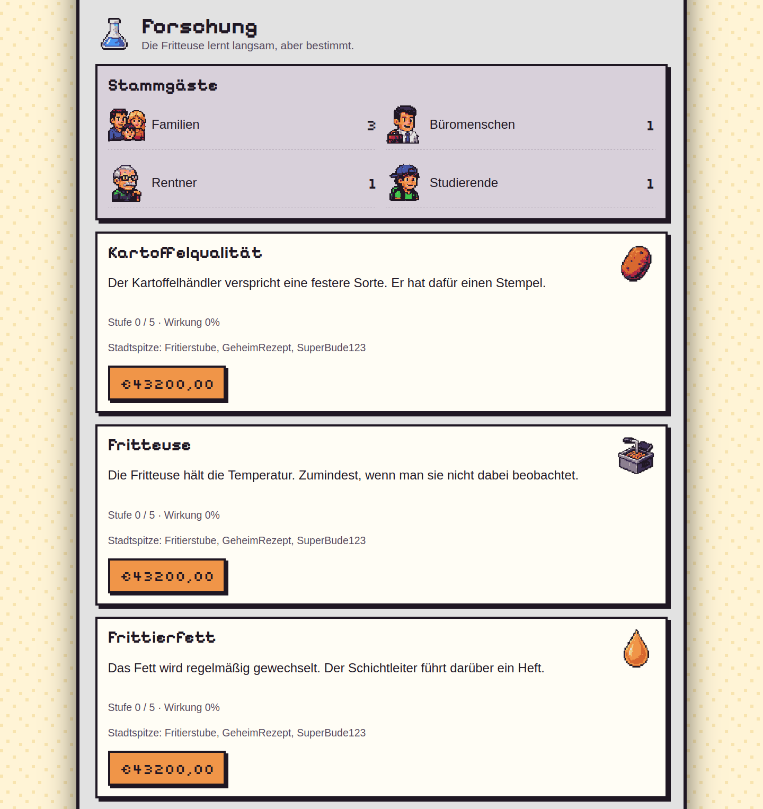
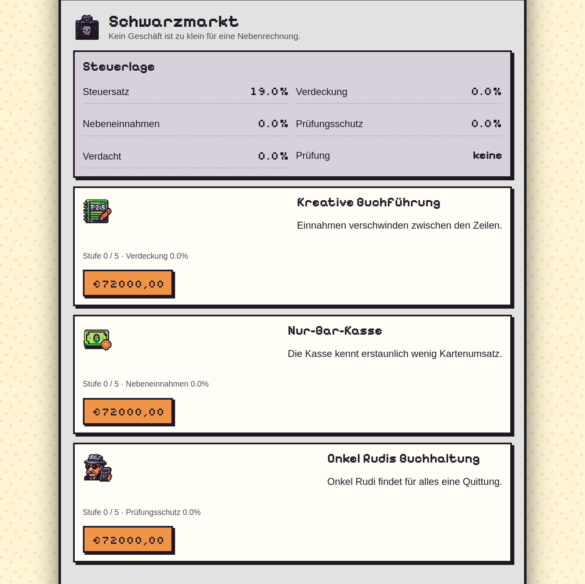

# Pommes Connection

A small multiplayer browser game about German **Pommesbuden**: chip shops with competitors, regulars, and questionable bookkeeping.

Three players share a city for seven real-time days. The market advances every 30 seconds, even while players are offline.
The shop with the most **Prestige**, not the most money, wins *Die goldene Pommes*.



The shop dashboard: finances, customers, and the neighborhood competition.

## The game

- **Find a market:** configure three dishes, prices, portions, toppings, seasoning, and the shop interior.
- **Read the neighborhood:** six customer groups have different preferences; population, demand, and market memory evolve.
- **Build a reputation:** win market share, attract regulars, and invest in research.
- **Interfere:** attract customers or disrupt competitors through two action slots, each with a twelve-hour cooldown.
- **Keep creative accounts:** black-market upgrades offer untaxed income, with suspicion, audits, and Prestige penalties attached.

Create a game, invite two competitors, and start the week.
The German-language, mobile-first interface pairs pixel art with deadpan neighborhood bureaucracy.
Even the fryer has standards:

> Die Fritteuse hält die Temperatur. Zumindest, wenn man sie nicht dabei beobachtet.

## Screenshots

<details>
<summary>Explore the menu, market, actions, research, and black market</summary>

**Menu configuration** — Adjust dishes and prices, then preview their effect on the market.



**Market shares** — See which shops attract each of the six customer groups.



**City statistics** — Compare demographics and track competitors’ market shares across the game.



**Actions** — Choose a target for an influencer visit, arriving punks, or a new parking arrangement.



**Research** — Improve potatoes, equipment, and recipes; keep an eye on regular customers.



**Black market** — Invest in questionable bookkeeping while monitoring suspicion and audit risk.



</details>

## How it was made

At the time, I wanted to understand the tradeoffs of implementing a project with a coding agent.
Some observations: I could discuss the game mechanics at a higher level.
There were quirks in the UI and logic that needed attention.
Being unfamiliar with the code felt weird at the time, leaving me disconnected from the implementation.

## Under the hood

**Clojure · Kit/Integrant · Ring/Reitit · Hiccup · HTMX/Alpine.js · next.jdbc/SQLite · Migratus**

Pure simulation functions separate market rules from HTTP and persistence.
Seeded scenarios support repeatable balancing without a server or database.
Scheduled ticks persist transactionally; tests cover simulation behavior, game lifecycle, and HTTP requests.
Docker Compose, Caddy, and GitHub Actions provide the single-server deployment path.

## Run locally

Requires Java 21 and the Clojure CLI.

```sh
mkdir -p data
clj -M:dev
```

Start the server from the REPL:

```clojure
(go)
```

Open [localhost:3333](http://localhost:3333). Run tests with `clj -M:test`; reload changes with `(reset)`.

[Development and deployment](docs/development.md) · [Winning](goal.md) · [Balancing](balancing.md) · [Narrative](narrative.md) · [Visual direction](visual.md)
